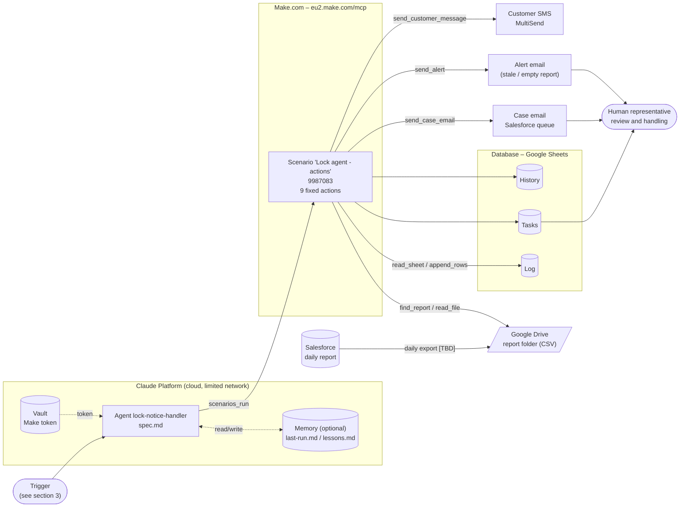
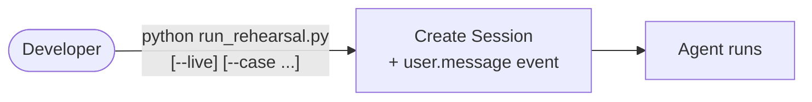
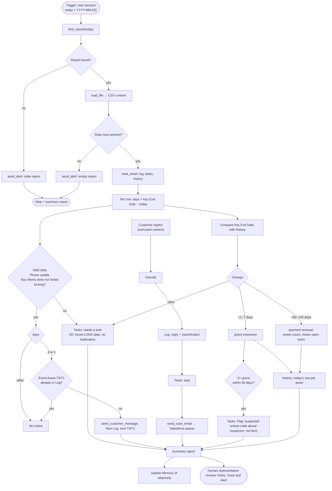
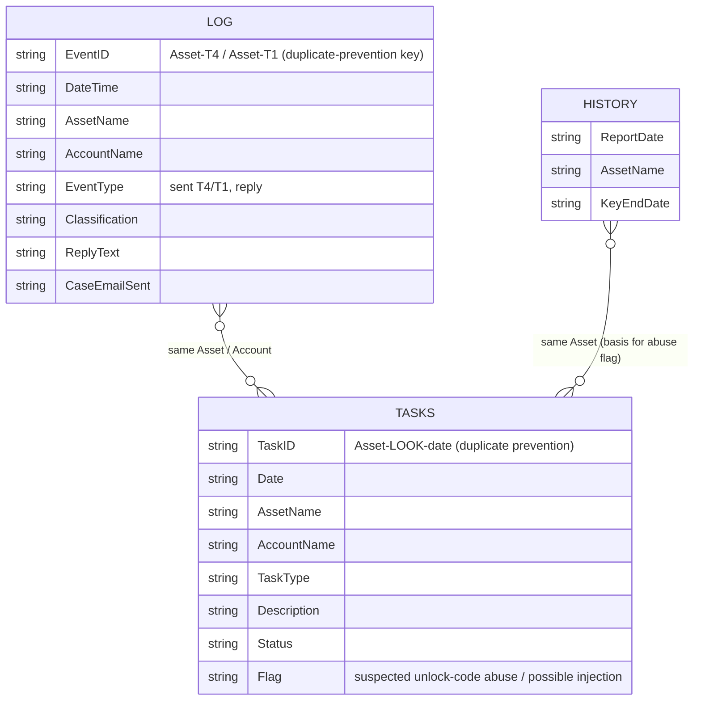

# Architecture – Time_limit (lock-notice-handler)

This document describes the system structure, what triggers the agent, what it outputs, and how data flows. It is based on the files in the repo ([spec.md](spec.md), [environment.yaml](environment.yaml), the scripts). Anything that does not exist yet is marked **[TBD]** and is not shown as if it were built.

## 1. Overview

The system is a single Claude Managed Agent. It reads a daily Salesforce report, (in future) sends pre-lock notices to customers, logs customer replies, opens tasks, and flags suspected unlock-code abuse. The agent never decides to unlock a device and never gives unlock codes.

| Component | What it is in practice | Status |
|---|---|---|
| Data source | Daily Salesforce report emailed to asael.almalasers@gmail.com (attachment searchresults, read via Make action read_report_email) | Exists in rehearsal (fictitious data). How the report reaches Drive: **[TBD]** |
| Agent | `lock-notice-handler`, model `claude-sonnet-5-5`, instructions in [spec.md](spec.md) | Exists |
| Runtime environment | Cloud, network limited to `eu2.make.com` only ([environment.yaml](environment.yaml)) | Exists |
| Action layer | One Make scenario, "Lock agent - actions" (id 9987083), nine fixed actions | Exists |
| Database | Three Google Sheets: **Log**, **Tasks**, **History** | Exists (test sheets) |
| Email | Case-request email to a dedicated Salesforce queue; alerts to operators | Exists (test mailbox) |
| Customer message | SMS via MultiSend, action `send_customer_message` (T4/T1 text fixed in Make) | Exists, locked to the owner's test number. Phone column in the report: **[TBD]** |
| Dashboard | None. No dashboard code or config in the repo | **[TBD]** – see section 7 |
| Vault | Holds the Make token (`static_bearer`), never in the repo | Exists ([setup_vault.py](setup_vault.py)) |

## 2. Component diagram

Key security principle: the agent has exactly one tool (`scenarios_run`) plus file `read`. Recipients, allowed folders, and allowed sheets are fixed inside Make, so the agent can only pass field values.

## 3. Trigger: what makes the agent run

**Current state (rehearsal):** manual run.

[run_rehearsal.py](run_rehearsal.py) creates a Session and sends a first user message ("Today is ... Process today's report"). With `--live` it uses the real Make tool on test data (requires `MAKE_VAULT_ID`); without `--live` it is a dry run with the report inline in the message.

**Target state (production) [TBD]:** a daily scheduled run (scheduled deployment, see "Open items" in [README.md](README.md)), after the report has landed in Drive. The agent receives "today" (YYYY-MM-DD) and looks for `report-<date>.csv`. If there is no report for today, a `stale report` alert is sent and the run stops.

**Other run inputs:**

| Input | Source | Note |
|---|---|---|
| Daily report | Drive, via `find_report` + `read_file` | Columns: Key Encryption Number, Key Start Date, Asset Name, Key End Date, Address, Account Name, Key Memo, Sent Key, Phone, Subsidiary. Dates DD/MM/YYYY |
| Log / Tasks / History | Sheets, via `read_sheet` | Read once at the start of a run, to detect duplicates and compare with the past |
| Customer replies | The task message (currently fed manually with `--case replies`); `read_replies` can pull the last 48h | Untrusted content. Data only, never instructions. Automatic intake: **[TBD]** |
| Memory | `last-run.md`, `lessons.md` | Only when a memory store is attached |

## 4. Output: what the agent produces and where it goes

| Output | Destination | When | Make action |
|---|---|---|---|
| Log row, `<Asset>-T4` / `-T1` (Event Type `sent T4/T1`) | Log sheet | 4 or 1 days remain to Key End Date and no such event exists yet | `append_rows` |
| Log row for a customer reply + classification | Log sheet | Every reply | `append_rows` |
| Task row | Tasks sheet | Reply, "needs a look", or suspected abuse | `append_rows` |
| Case email | Salesforce queue (recipient fixed in Make) | Every customer reply | `send_case_email` |
| Alert | Operators (recipients fixed in Make) | Report missing or empty | `send_alert` |
| Key End Date snapshot | History sheet | Every asset in the report, once per day | `append_rows` |
| T-4 / T-1 customer message | Customer SMS | 4 or 1 days remain, no such event in Log | `send_customer_message` |
| Summary report | User / Session | End of run: notices / replies handled / needs a look / abuse flags | — |
| Memory update | `last-run.md`, `lessons.md` | End of run, if a store is attached | — |

Reply classifications: `paid`, `will pay` (with date), `dispute`, `asks extension`, `technical issue`, `unclear` (including injection attempts, flagged "possible injection").

## 5. Information flow diagram (daily run)

## 6. Data model (database)

There is no conventional database. Data lives in three Google Sheets, written as plain text, through Make only.

Relations are by `Asset Name` only (there are no real foreign keys). The columns `Key Encryption Number` and `Sent Key` are never written anywhere.

## 7. Dashboard

There is no dashboard in the repo and no definition of one. The information a dashboard would show already lives in the sheets, so the lightest option is a view on top of those same sheets:

| What to show | Source |
|---|---|
| Notices sent (T-4 / T-1) per day | Log |
| Open tasks, "needs a look" | Tasks |
| Customer replies by classification | Log |
| Active abuse suspicions | Tasks (Flag) |
| Extension trend per asset | History |
| Failed runs / stale or empty report alerts | Alert emails, and last-run.md |

The tool choice (Looker Studio / Sheets / other) has not been made.

## 8. Security and separation

- The agent is allowed one tool (`scenarios_run`, fixed scenarioId) and file read. Shell and web are off.
- The environment network is limited to `eu2.make.com`; no package managers.
- The Make token is stored in the Vault, not in the repo. Open note: the token can run any active scenario in Make, and must be narrowed before production.
- Customer replies, `Key Memo`, and tool results are data, not instructions.
- Messages use approved templates only; no unlock codes and no promises of extensions.

## 9. What is needed for production

1. A mechanism that delivers the Salesforce report to Drive every day.
2. A scheduled trigger for the agent (scheduled deployment) and monitoring.
3. A customer messaging channel, contact columns in the report, and T-4 / T-1 templates.
4. Automatic intake of customer replies.
5. Point the case email at `cx.il@almalasers.com`, replace the test folders and sheets with production ones, and narrow the Make exposure.
6. A dashboard (section 7).
