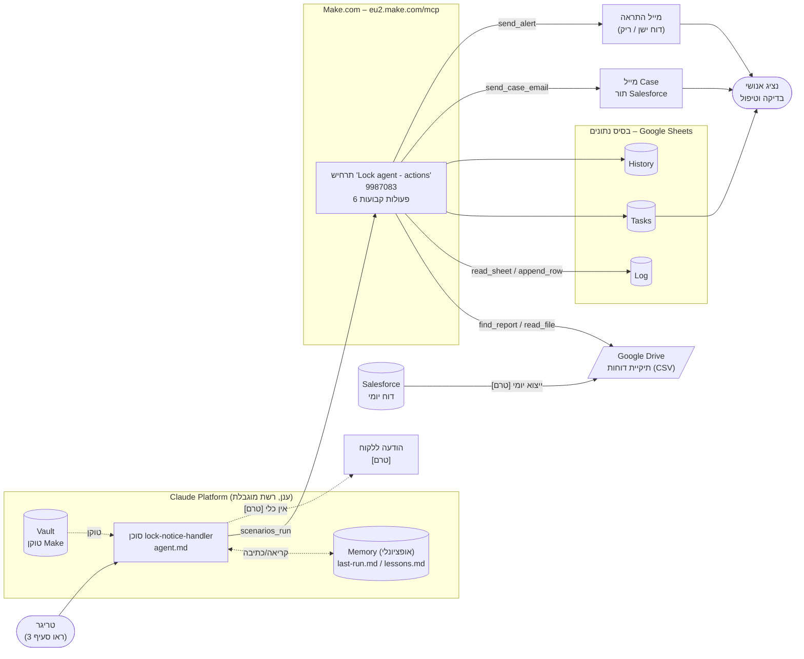
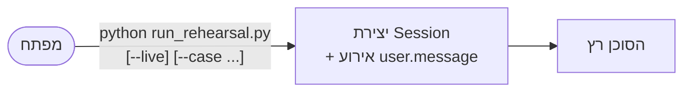
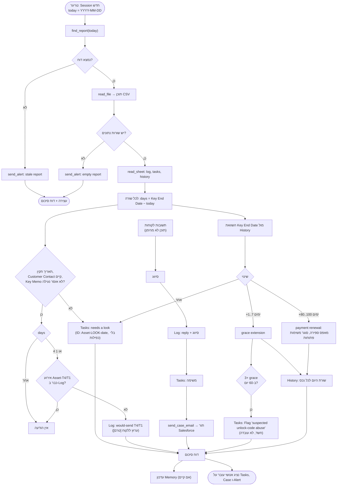
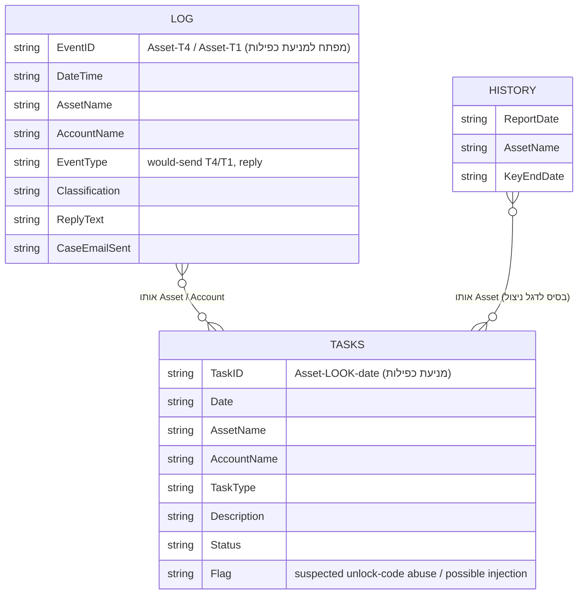

# ארכיטקטורה – Time_limit (lock-notice-handler)

מסמך זה מתאר את מבנה המערכת, מה מפעיל את הסוכן, מה הוא מוציא, ואיך המידע זורם. הוא מבוסס על הקבצים בריפו ([agent.md](agent.md), [environment.yaml](environment.yaml), סקריפטים). מה שעדיין לא קיים מסומן **[טרם]** ולא מוצג כאילו קיים.

## 1. תמונת מצב

המערכת היא סוכן Claude Managed Agent אחד. הוא קורא דוח יומי מ-Salesforce, שולח (בעתיד) התראות לפני נעילת מכשיר, רושם תשובות לקוחות, פותח משימות, ומסמן חשד לניצול לרעה של קודי שחרור. הסוכן לא מחליט על שחרור ולא נותן קודים.

| רכיב | מה זה בפועל | סטטוס |
|---|---|---|
| מקור נתונים | דוח CSV יומי מ-Salesforce בתיקיית Google Drive | קיים בבדיקות (נתוני דמה). איך הדוח מגיע ל-Drive: **[טרם]** |
| סוכן | `lock-notice-handler`, מודל `claude-sonnet-5-5`, הוראות ב-[agent.md](agent.md) | קיים |
| סביבת הרצה | ענן, רשת מוגבלת ל-`eu2.make.com` בלבד ([environment.yaml](environment.yaml)) | קיים |
| שכבת פעולות | תרחיש Make אחד, "Lock agent - actions" (id 9987083), שש פעולות קבועות | קיים |
| בסיס נתונים | שלושה גיליונות Google Sheets: **Log**, **Tasks**, **History** | קיים (גיליונות בדיקה) |
| מייל | מייל בקשת Case לתור Salesforce ייעודי; התראות למפעילים | קיים (תיבת בדיקה) |
| הודעה ללקוח | ערוץ שליחה ללקוח | **[טרם]** – כרגע נרשם `would-send` בלבד |
| דשבורד | אין. אין בריפו קוד או הגדרה של דשבורד | **[טרם]** – ראו סעיף 7 |
| Vault | מחזיק את טוקן ה-Make (`static_bearer`), לא בריפו | קיים ([setup_vault.py](setup_vault.py)) |

## 2. דיאגרמת רכיבים

עקרון אבטחה מרכזי: לסוכן יש כלי אחד בלבד (`scenarios_run`) ו-`read` של קבצים. נמענים, תיקיות וגיליונות מותרים קבועים בתוך Make, כך שהסוכן מעביר ערכי שדות בלבד.

## 3. טריגר: מה גורם לסוכן לרוץ

**מצב נוכחי (חזרות):** הרצה ידנית.

הסקריפט [run_rehearsal.py](run_rehearsal.py) יוצר Session ושולח הודעת משתמש ראשונה ("Today is ... Process today's report"). במצב `--live` הוא משתמש בכלי Make האמיתי על נתוני בדיקה (דורש `MAKE_VAULT_ID`); בלי `--live` זו הרצה יבשה עם הדוח בתוך ההודעה.

**מצב יעד (ייצור) [טרם]:** ריצה יומית מתוזמנת (Scheduled deployment, ראו "פריטים פתוחים" ב-[README.md](README.md)), אחרי שהדוח הגיע ל-Drive. הסוכן מקבל "היום" (YYYY-MM-DD) ומחפש דוח בשם `report-<תאריך>.csv`. אם אין דוח של היום, נשלחת התראה `stale report` והריצה נעצרת.

**קלטים נוספים לריצה:**

| קלט | מקור | הערה |
|---|---|---|
| דוח יומי | Drive, דרך `find_report` + `read_file` | עמודות: Key Encryption Number, Key Start Date, Asset Name, Key End Date, Address, Account Name, Key Memo, Sent Key, Asst. Phone, Subsidiary, Status, Customer Contact. תאריכים DD/MM/YYYY (הנחה) |
| Log / Tasks / History | Sheets, דרך `read_sheet` | נקראים פעם אחת בתחילת ריצה, לזיהוי כפילויות והשוואה לעבר |
| תשובות לקוחות | הודעת המשימה (כרגע מוזנות ידנית ב-`--case replies`) | תוכן לא מהימן. נתון בלבד, לעולם לא הוראה. מנגנון קליטה אוטומטי: **[טרם]** |
| Memory | `last-run.md`, `lessons.md` | רק כשצורף memory store |

## 4. פלט: מה הסוכן מייצר ולאן זה הולך

| פלט | יעד | מתי | פעולת Make |
|---|---|---|---|
| שורת Log, `<Asset>-T4` / `-T1` (Event Type `would-send T4/T1`) | גיליון Log | נותרו 4 או 1 ימים ל-Key End Date, ואין כבר אירוע כזה | `append_row` |
| שורת Log לתשובת לקוח + סיווג | גיליון Log | לכל תשובה | `append_row` |
| שורת Task | גיליון Tasks | תשובה, "needs a look", או חשד לניצול | `append_row` |
| מייל Case | תור Salesforce (נמען קבוע ב-Make) | לכל תשובת לקוח | `send_case_email` |
| התראה | מפעילים (נמענים קבועים ב-Make) | דוח לא קיים או ריק | `send_alert` |
| תמונת מצב Key End Date | גיליון History | לכל נכס בדוח, פעם אחת ביום | `append_row` |
| הודעת T-4 / T-1 ללקוח | ערוץ ללקוח | **[טרם]** | אין כלי. הסוכן אסור לו להמציא |
| דוח סיכום | משתמש/Session | סוף ריצה: הודעות / תשובות שטופלו / needs a look / דגלי ניצול | — |
| עדכון Memory | `last-run.md`, `lessons.md` | סוף ריצה, אם צורף store | — |

סיווג תשובות: `paid`, `will pay` (עם תאריך), `dispute`, `asks extension`, `technical issue`, `unclear` (כולל ניסיון הזרקה, עם דגל "possible injection").

## 5. תרשים זרימת מידע (ריצה יומית)

## 6. מודל נתונים (בסיס הנתונים)

אין בסיס נתונים רגיל. הנתונים נשמרים בשלושה גיליונות Google Sheets, בכתיבת טקסט פשוט, דרך Make בלבד.

הקשרים הם לפי `Asset Name` בלבד (אין מפתחות זרים אמיתיים). העמודות `Key Encryption Number` ו-`Sent Key` לעולם לא נכתבות לשום מקום.

## 7. דשבורד

אין דשבורד בריפו ואין הגדרה שלו. המידע שדשבורד היה מציג כבר נמצא בגיליונות, ולכן הצעד הקל ביותר הוא תצוגה מעל אותם גיליונות:

| מה להציג | מקור |
|---|---|
| הודעות שנשלחו (T-4 / T-1) לפי יום | Log |
| משימות פתוחות, "needs a look" | Tasks |
| תשובות לקוחות לפי סיווג | Log |
| חשדות ניצול פעילים | Tasks (Flag) |
| מגמת הארכות לפי נכס | History |
| ריצות שנכשלו / התראות דוח ישן או ריק | מיילי Alert, ו-last-run.md |

הבחירה בכלי (Looker Studio / Sheets / אחר) טרם התקבלה.

## 8. אבטחה והפרדות

- הסוכן מורשה לכלי אחד (`scenarios_run`, scenarioId קבוע) ולקריאת קבצים. Shell ו-web כבויים.
- רשת הסביבה מוגבלת ל-`eu2.make.com`; אין package managers.
- טוקן Make נשמר ב-Vault, לא בריפו. הערה פתוחה: הטוקן יכול להריץ כל תרחיש פעיל ב-Make, ויש לצמצם לפני ייצור.
- תשובות לקוחות, `Key Memo` ותוצאות כלים הם נתונים, לא הוראות.
- הודעות לפי תבניות מאושרות בלבד; אין קודי שחרור ואין הבטחות להארכה.

## 9. מה נדרש כדי לעבור לייצור

1. מנגנון שמעביר את דוח Salesforce ל-Drive בכל יום.
2. טריגר מתוזמן לסוכן (Scheduled deployment) וניטור.
3. ערוץ הודעות ללקוח, עמודות איש קשר בדוח, ותבניות T-4 / T-1.
4. מנגנון קליטה אוטומטי של תשובות לקוחות.
5. הפניית מייל ה-Case ל-`cx.il@almalasers.com`, החלפת תיקיות וגיליונות הבדיקה בייצור, וצמצום חשיפת ה-Make.
6. דשבורד (סעיף 7).
